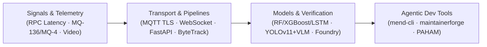

```text
┌──────────────────────────────────────────────────────────────────────────┐
│  0xbonson :: Ammar Fasya                                                │
│  Computer Engineering · Networks & HPC · AI Agents · Signal Systems      │
└──────────────────────────────────────────────────────────────────────────┘
```

I am a Computer Engineering undergraduate interested in how **noisy real-world signals** (network latency, IoT gas sensors, video frames, blockchain calldata) become **observable, reliable software** — and how **AI agents and developer tools** can operate safely on top of them.

Instead of chasing abstract benchmarks, I learn best by wiring systems end-to-end: from telemetry capture and transport protocols to automated tooling and evaluation.

---

### How My Projects Connect



---

### Verified Selected Work *(Recommended Pins)*

| System | Stack & Protocol | Verified Engineering Detail |
| :--- | :--- | :--- |
| [**mend-cli**](https://github.com/0xbonson/mend-cli) | `TypeScript` · `CLI` | Atomic multi-file code patcher for LLM edits; supports 4 formats (`unified`, `search-replace`, `v4a`, `json`) with 3-tier whitespace/indentation reconciliation. |
| [**nexgas-backend**](https://github.com/0xbonson/nexgas-backend) | `TypeScript` · `Express 5` · `MQTT TLS` · `SQLite WAL` | Cloud telemetry backend for ESP32 biogas reactors ($\text{CH}_4$, $\text{H}_2\text{S}$, pressure) over HiveMQ TLS (8883), `ws` gateway, and Turso/libSQL offline resilience. |
| [**video-object-tracking**](https://github.com/0xbonson/video-object-tracking) | `Python 3.11` · `YOLOv11` · `ByteTrack` · `Ollama` | Local-first CV pipeline isolating primary subjects (`>15%` bbox area), sampling every `3s` into deterministic `qwen2.5vl:3b` (`temp=0.0`) JSON, with DB/file GC. |
| [**maintainerforge**](https://github.com/0xbonson/maintainerforge) | `Python` · `GitHub Actions` | Read-only-by-default OSS maintainer toolkit for rule-based issue triage, file-path PR risk scoring, security checklists, and CI JSON output. |
| [**pariter**](https://github.com/0xbonson/pariter) | `Solidity` · `Foundry` · `TypeScript` | Non-custodial USDC batch payout & settlement verifier on Arc Mainnet (`5042`); `19/19` Foundry & `53/53` Vitest passing (*Circle Arc Microgrants 2026*). |
| [**paham**](https://github.com/0xbonson/paham) | `Next.js` · `TypeScript` · `Solidity` | Pre-sign Web3 security layer ([live](https://paham-eta.vercel.app)) surfacing semantic diffs between UI intent and raw transaction calldata (*ID Web3 Hackathon 2026*). |

*(Also building [**rumiflux-ai**](https://github.com/0xbonson/rumiflux-ai) — biogas pre-feasibility decision support with Python, MCP, Langflow & Astra DB.)*

---

### Research & Field Programs

- **Undergraduate Thesis — RPC Latency Forecasting**: Collected empirical RPC endpoint latency time-series and benchmarked lag-engineered forecasting models (**Random Forest $R^2 = 0.845$, $\text{MAE} = 12.79\text{ ms}$** vs. XGBoost $0.843$, LSTM $0.818$, Linear Regression $0.769$; without lag features $R^2$ drops to $-3.64$).
- **APIE Advance Camp (Japan)**: Hands-on network engineering, Linux, and containerized service architecture (`Docker`, `Nginx`, `Flask`).

---

### Core Stack

`Python` · `TypeScript` · `Linux` · `Docker` · `MQTT / WebSockets` · `Git` · `Solidity`

`X:` [@0xbonson](https://x.com/0xbonson)
