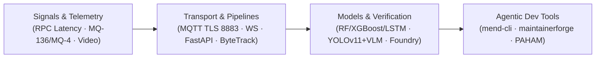

<div align="center">


<br/>


<br/>

<p align="center">
  <a href="https://github.com/0xbonson?tab=repositories"></a>
  <a href="https://x.com/0xbonson"></a>
  <a href="https://paham-eta.vercel.app"></a>
  
</p>

</div>

---

### `whoami`

```python
class Engineer:
    name: str = "Ammar Fasya (0xbonson)"
    education: str = "B.Eng. Computer Engineering, Universitas Syiah Kuala"
    focus: list[str] = [
        "Computer Networks & High-Performance Computing (HPC)",
        "AI Agents & Developer Tooling",
        "Signal-Driven Systems & IoT Telemetry",
    ]
    philosophy: str = (
        "Understand how noisy real-world signals behave, wire systems end-to-end, "
        "and build deterministic tooling around them."
    )
```

I am a Computer Engineering undergraduate who learns by wiring systems from end to end — turning noisy network latency, sensor telemetry, video frames, and raw calldata into **observable, verifiable software**.

---

### Architecture Map



---

### Featured Engineering Projects

#### 🔧 [mend-cli](https://github.com/0xbonson/mend-cli) — Atomic Multi-File Code Patcher
A deterministic CLI built to reconcile imprecise diffs generated by AI coding agents across a repository.
- **4 Patch Formats:** Auto-detects and parses `unified` diffs, `SEARCH/REPLACE` blocks, `V4A` multi-file patches, and `JSON` tool edits (`create`, `str_replace`, `insert`).
- **3-Tier Matching:** Falls back cleanly from exact match (`Tier 0`) → trailing whitespace trim (`Tier 1`) → indent-reconciling match (`Tier 2`), with `--strict` mode for exact enforcement.
- **Atomicity:** All-or-nothing disk writes so partial/broken patches never corrupt a repository.

`TypeScript` `CLI` `Diff/Patch Engine` `AI DevTools`

---

#### 📡 [nexgas-backend](https://github.com/0xbonson/nexgas-backend) — Real-Time IoT Biogas Telemetry Backend
Cloud backend for **NEX-GAS**, monitoring anaerobic biogas reactors ($\text{CH}_4$, $\text{H}_2\text{S}$, ambient leaks, digester pressure) in real time.
- **Transport Pipeline:** Ingests sensor frames from **ESP32 DevKit** (`MQ-136`, `MQ-4`, `DHT22`) over **HiveMQ Cloud MQTT via TLS (port 8883)** and streams live state via `ws` WebSocket gateway.
- **Persistence & Resilience:** Express 5 + TypeScript (NodeNext ESM) backed by **Turso Cloud (libSQL)** and local **SQLite WAL** (`better-sqlite3`), preserving historical telemetry and last-known snapshots even when hardware goes offline.

`TypeScript` `Express 5` `MQTT TLS` `WebSockets` `Turso / SQLite WAL`

---

#### 🎥 [video-object-tracking](https://github.com/0xbonson/video-object-tracking) — Local-First CV & VLM Attribute Pipeline
Tracks primary subjects in video footage and extracts structured semantic attributes locally without cloud VLM dependencies.
- **Pipeline:** `Video → YOLOv11 → ByteTrack → >15% BBox Area Filter → 3s Time-Based Crop → Ollama (qwen2.5vl:3b) → SQLite → React`.
- **Latency & Hallucination Control:** Filters background crowds via bounding-box area threshold, samples every 3 seconds to avoid VLM bottlenecks, and constrains `qwen2.5vl:3b` at `temperature=0.0` for deterministic JSON output.
- **Storage GC:** Synchronizes React frontend deletions with physical cropped-frame cleanup on the FastAPI backend.

`Python 3.11` `YOLOv11` `ByteTrack` `FastAPI` `Ollama VLM` `React`

---

#### 🛡️ [maintainerforge](https://github.com/0xbonson/maintainerforge) & [pariter](https://github.com/0xbonson/pariter) & [paham](https://github.com/0xbonson/paham)
- **MaintainerForge** (`Python` · `GitHub Actions`): Auditable, *read-only-by-default* OSS maintainer toolkit for rule-based issue classification, file-path PR risk scoring, security checklists, and release-note generation.
- **Pariter** (`Solidity` · `Foundry` · `TypeScript`): Non-custodial USDC batch payout & settlement verification engine on **Circle Arc Mainnet (`5042`)** — **`19/19` Foundry & `53/53` Vitest passing** (*Circle Arc Microgrants 2026*).
- **PAHAM** (`Next.js` · `TypeScript` · `Solidity`): Pre-sign Web3 security layer ([live app](https://paham-eta.vercel.app)) revealing semantic diffs between UI intent and raw transaction calldata (*Indonesia Web3 Hackathon 2026*).

---

### Research & Field Programs

- **Undergraduate Thesis — RPC Latency Forecasting:** Collected empirical blockchain RPC endpoint latency time-series and benchmarked lag-engineered models — **Random Forest achieved $R^2 = 0.845$ ($\text{MAE} = 12.79\text{ ms}$, $\text{RMSE} = 20.34\text{ ms}$)**, outperforming XGBoost ($0.843$), LSTM ($0.818$), and Linear Regression ($0.769$), while proving lag features are critical (without lag, $R^2$ collapses to $-3.64$).
- **APIE Advance Camp (Japan):** Hands-on network engineering, Linux administration, and containerized infrastructure labs (`Docker`, `Nginx`, `Flask`).

---

### Tech Stack

<p align="center">
  
  
  
  
  
  
  
  
  
</p>


